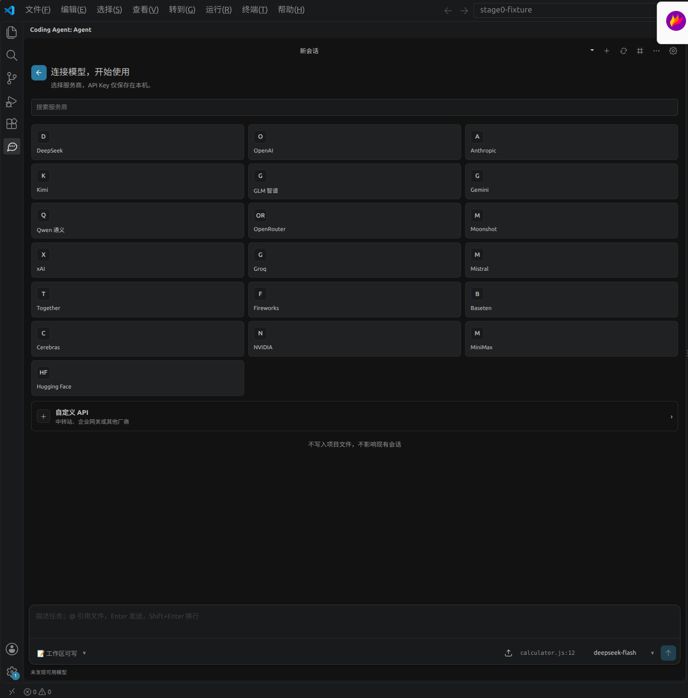
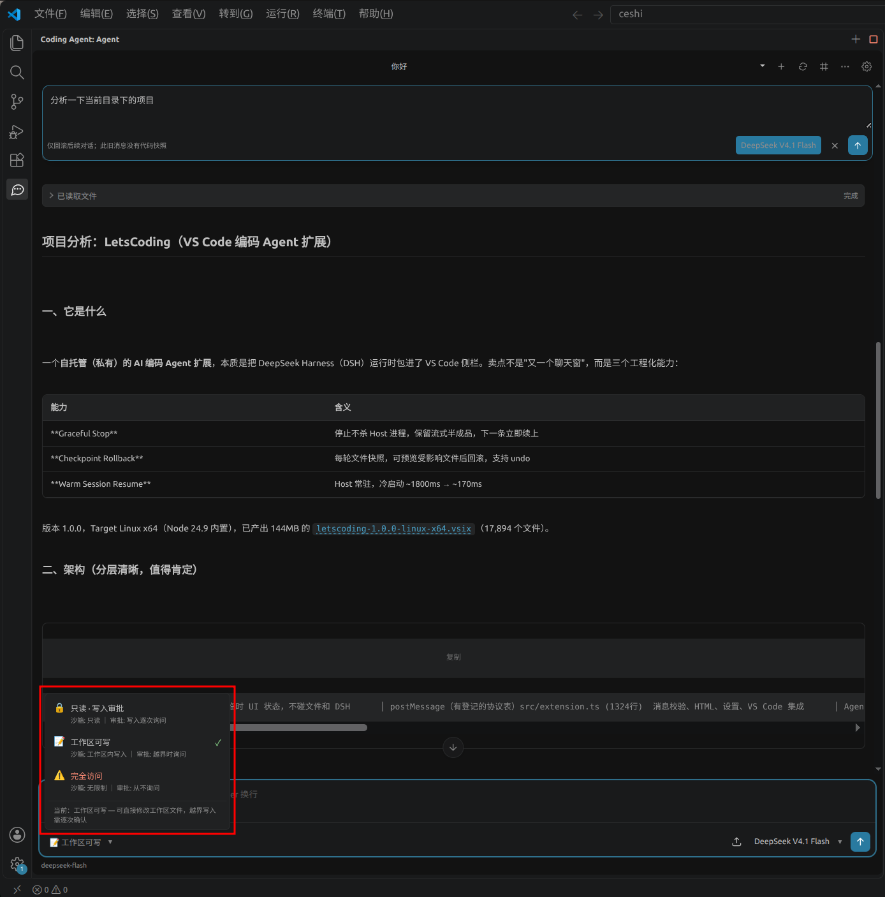
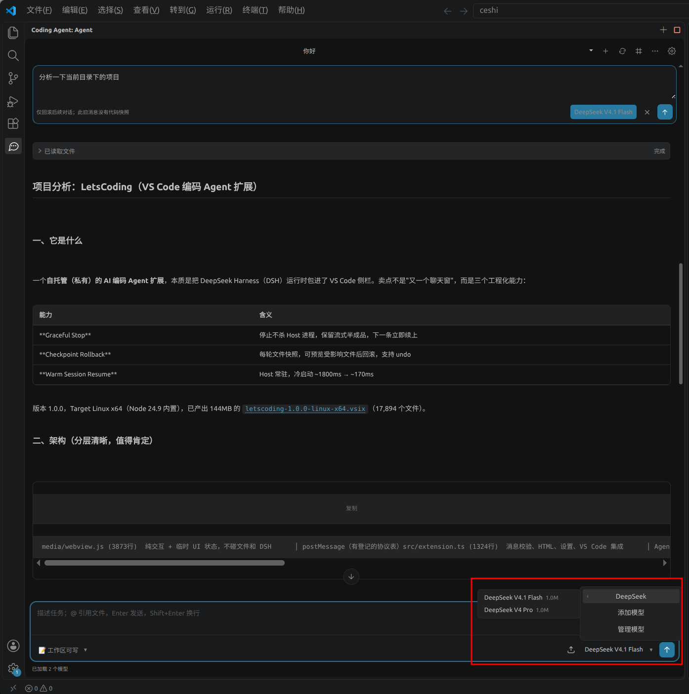

# LetsCoding

A VS Code coding agent with graceful stop, checkpoint rollback, and warm session resume.

## Screenshots

| 模型配置 | 添加 DeepSeek 模型 | 正常交互 |
|:---:|:---:|:---:|
|  |  |  |

| 历史消息回滚 | 沙箱权限设置 | 模型下拉选择 |
|:---:|:---:|:---:|
|  |  |  |

## Features

- **Graceful Stop** — Cancel active turns without killing the Host process; partial output is preserved and follow-up prompts resume instantly
- **Checkpoint Rollback** — Preview affected files, confirm rollback, and restore code state with undo support
- **Warm Session Resume** — Host processes stay warm between turns, eliminating cold-start delays
- **Multi-Session Management** — Create, switch, and run background sessions with persistent state
- **Inline Diff Review** — Review AI-generated changes directly in the editor
- **Model Routing** — Switch models per-turn while preserving session context
- **File Context & @ References** — Attach workspace files and editor selections to prompts
- **Structured Questions** — AI can ask clarifying questions with predefined options

## Quick Install

Download the latest `.vsix` from [Releases](https://github.com/xujianwei-ai/letscoding/releases) and install:

```bash
code --install-extension letscoding-1.0.0-linux-x64.vsix
```

The VSIX bundles Node.js and the DSH runtime—no external dependencies required.

### First-Time Setup

1. After installation, open the LetsCoding sidebar from the VS Code activity bar
2. Click **"添加模型服务"** (Add Model Service) to configure your API Key
3. Select a model from the dropdown and start coding

> **Note**: The default `deepseek-flash` is a placeholder. You must configure an API Key before sending messages.

## Build from Source

### Prerequisites

- Node.js 24+
- npm

### Steps

```bash
# Clone with DSH submodule
git clone --recursive https://github.com/xujianwei-ai/letscoding.git
cd letscoding/vscode-coding-agent

# Install dependencies
npm install

# Compile
npm run compile

# Package VSIX (includes runtime baseline, staging, and packaging)
npm run vsix:package

# Output: letscoding-1.0.0-linux-x64.vsix
```

### Development

```bash
# Quick tests (no model/VS Code required)
npm run test:quick

# Integration tests (requires VS Code + model credentials)
node scripts/vscode-integration.cjs vscode-suite.cjs

# Graceful stop integration
VSCODE_AGENT_SUITE=cancel-integration-suite.cjs node scripts/vscode-integration.cjs
```

## Architecture

```
vscode-coding-agent/          # VS Code extension
├── src/                      # TypeScript source
├── media/                    # Webview frontend
├── scripts/                  # Build & test scripts
├── docs/                     # Feature documentation
└── .runtime-build/           # Bundled Node/DSH runtime (generated)

../dsh-learning/deepseek-harness/  # DSH runtime (git submodule)
└── packages/sdk/             # JSON-RPC SDK with session/cancel support
```

## License

- **LetsCoding extension**: MIT © 2026 许建伟
- **DSH runtime**: MIT © 2026 DeepSeek (see `dsh-learning/deepseek-harness/LICENSE`)
- **Bundled Node.js**: See `.runtime-build/node/LICENSE`

## Known Issues

- **Placeholder model**: The default `deepseek-flash` model requires API Key configuration before use. The extension now shows a friendly prompt instead of a raw error. [Issue #1](https://github.com/xujianwei-ai/letscoding/issues/1)

## Acknowledgments

Built on [DeepSeek Harness](https://github.com/deepseek-ai/deepseek-harness) (DSH), an open-source AI agent runtime.
