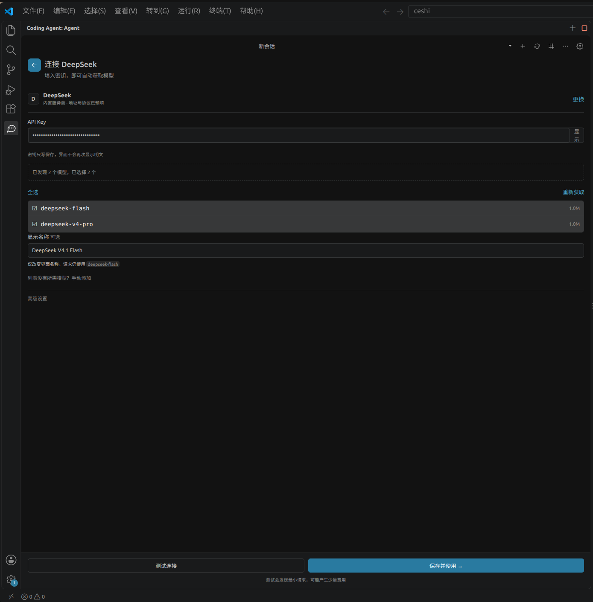
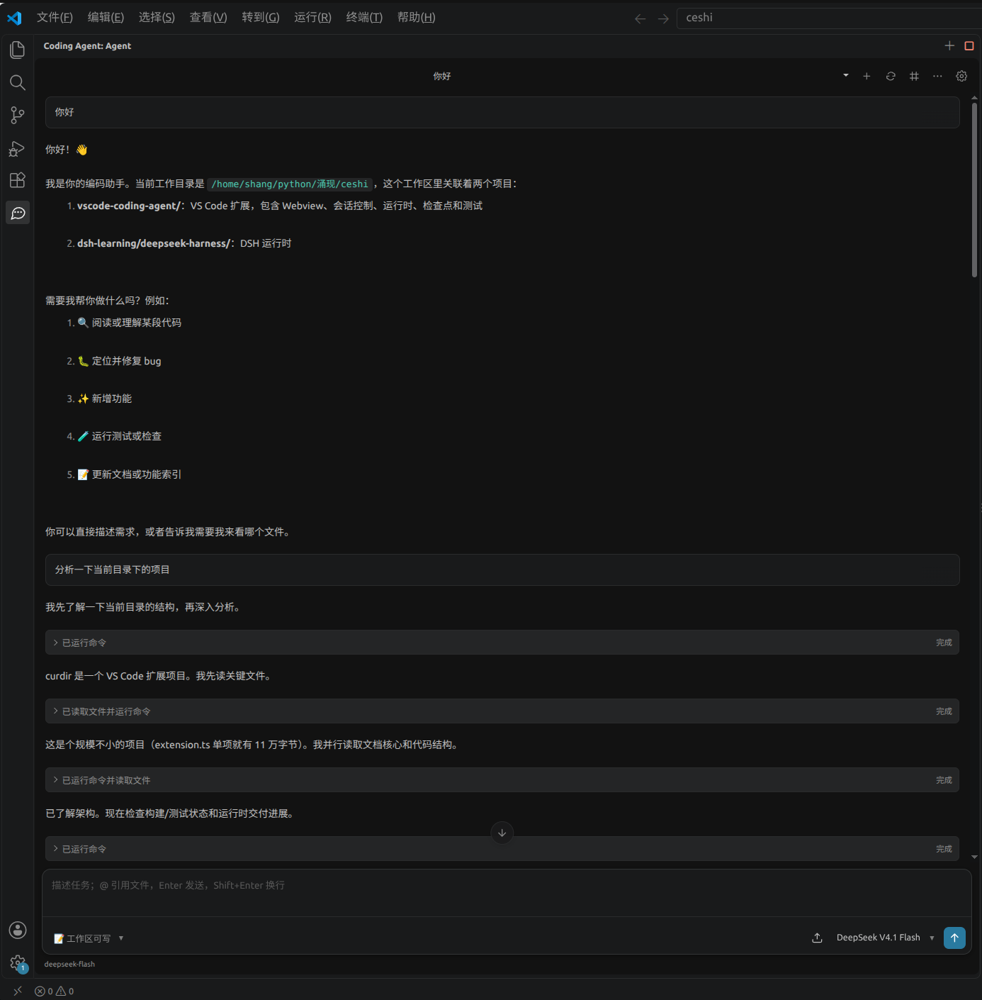
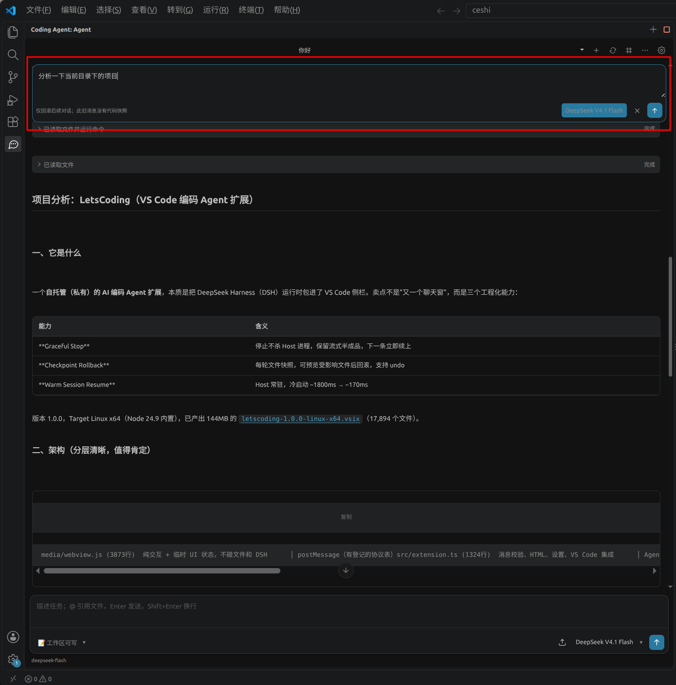
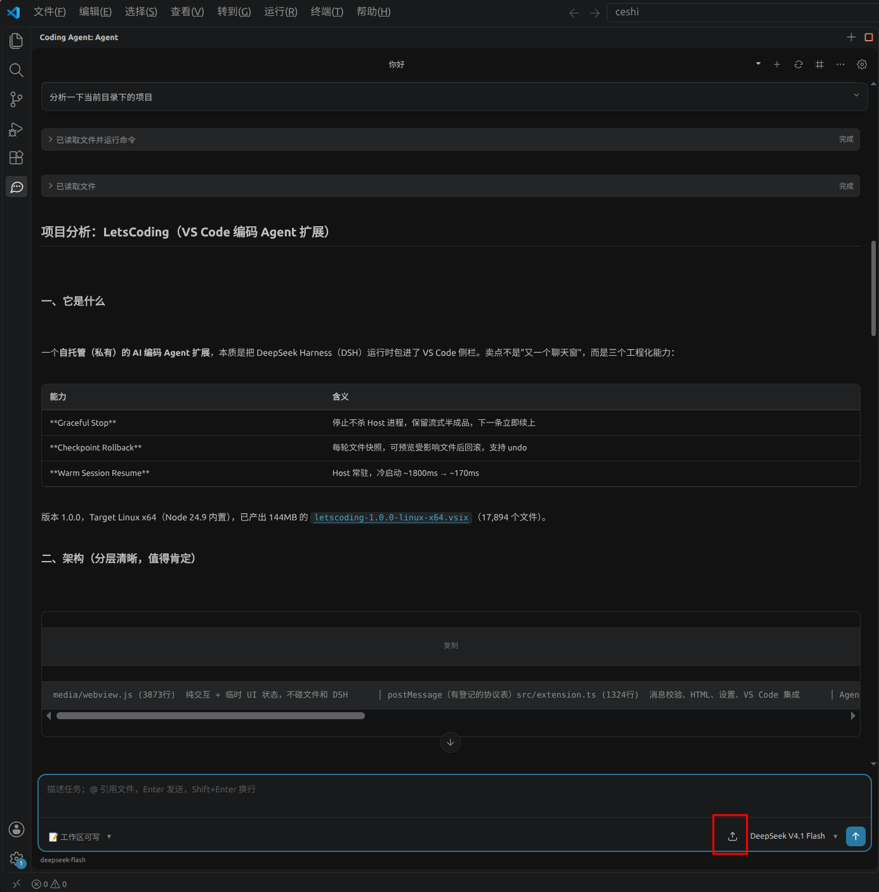

# LetsCoding

[English](#english) | [中文](#中文)

---

## English

A VS Code coding agent with graceful stop, checkpoint rollback, and warm session resume.

### Screenshots

| VS Code Install | Model Configuration | Add DeepSeek Model |
|:---:|:---:|:---:|
|  |  |  |

| Normal Interaction | Checkpoint Rollback | Sandbox Permissions |
|:---:|:---:|:---:|
|  |  |  |

| Model Selection | Local Image Upload |
|:---:|:---:|
|  |  |

### Features

- **Graceful Stop** — Cancel active turns without killing the Host process; partial output is preserved and follow-up prompts resume instantly
- **Checkpoint Rollback** — Preview affected files, confirm rollback, and restore code state with undo support
- **Warm Session Resume** — Host processes stay warm between turns, eliminating cold-start delays
- **Multi-Session Management** — Create, switch, and run background sessions with persistent state
- **Inline Diff Review** — Review AI-generated changes directly in the editor
- **Model Routing** — Switch models per-turn while preserving session context
- **File Context & @ References** — Attach workspace files and editor selections to prompts
- **Structured Questions** — AI can ask clarifying questions with predefined options

### Quick Install

Download the latest `.vsix` from [Releases](https://github.com/xujianwei-ai/letscoding/releases).

#### Recommended: Manual Install

1. Open VS Code
2. Go to **Extensions** view (`Ctrl+Shift+X`)
3. Click **"..."** (More Actions) → **"Install from VSIX..."**
4. Select the downloaded `.vsix` file
5. Reload VS Code when prompted

#### Alternative: Command Line

```bash
code --install-extension letscoding-1.0.0-linux-x64.vsix --force
```

> **Note**: If the extension does not appear after CLI install, use the manual method above or restart VS Code.

The VSIX bundles Node.js and the DSH runtime—no external dependencies required.

#### First-Time Setup

1. After installation, open the LetsCoding sidebar from the VS Code activity bar
2. Click **"Add Model Service"** to configure your API Key
3. Select a model from the dropdown and start coding

> **Note**: The default `deepseek-flash` is a placeholder. You must configure an API Key before sending messages.

### Build from Source

#### Prerequisites

- Node.js 24+
- npm

#### Steps

```bash
# Clone the repository
git clone https://github.com/xujianwei-ai/letscoding.git
cd letscoding

# Install dependencies
npm install

# Compile TypeScript
npm run compile

# Generate runtime baseline from bundled DSH source
npm run runtime:baseline

# Stage runtime (downloads Node.js if needed)
npm run runtime:stage

# Package VSIX
npm run vsix:package

# Output: letscoding-1.0.0-linux-x64.vsix
```

#### Development

```bash
# Quick tests (no model/VS Code required)
npm run test:quick

# Integration tests (requires VS Code + model credentials)
node scripts/vscode-integration.cjs vscode-suite.cjs

# Graceful stop integration
VSCODE_AGENT_SUITE=cancel-integration-suite.cjs node scripts/vscode-integration.cjs
```

### Architecture

```
letscoding/                    # Repository root
├── src/                       # VS Code extension TypeScript source
├── media/                     # Webview frontend
├── scripts/                   # Build & test scripts
├── docs/                      # Feature documentation & screenshots
├── dsh-learning/
│   └── deepseek-harness/      # DSH runtime source (with session/cancel)
├── .runtime-build/            # Generated: Node.js + DSH runtime closure
└── package.json               # Extension manifest
```

### License

- **LetsCoding extension**: MIT © 2026 许建伟
- **DSH runtime**: MIT © 2026 DeepSeek (see `dsh-learning/deepseek-harness/LICENSE`)
- **Bundled Node.js**: See `.runtime-build/node/LICENSE`

### Known Issues

- **Placeholder model**: The default `deepseek-flash` model requires API Key configuration before use. The extension now shows a friendly prompt instead of a raw error.

### Acknowledgments

Built on [DeepSeek Harness](https://github.com/deepseek-ai/deepseek-harness) (DSH), an open-source AI agent runtime.

---

## 中文

一个 VS Code 编程助手，支持优雅停止、检查点回滚和热会话恢复。

### 截图

| VS Code 安装 | 模型配置 | 添加 DeepSeek 模型 |
|:---:|:---:|:---:|
|  |  |  |

| 正常交互 | 历史消息回滚 | 沙箱权限设置 |
|:---:|:---:|:---:|
|  |  |  |

| 模型下拉选择 | 本地图片上传 |
|:---:|:---:|
|  |  |

### 功能特性

- **优雅停止** — 取消活跃轮次而不杀死 Host 进程；部分输出保留，后续提示立即恢复
- **检查点回滚** — 预览受影响文件、确认回滚、恢复代码状态，支持撤销
- **热会话恢复** — Host 进程在轮次间保持热备，消除冷启动延迟
- **多会话管理** — 创建、切换和后台运行会话，状态持久化
- **内联 Diff 审查** — 直接在编辑器中审查 AI 生成的更改
- **模型路由** — 逐轮切换模型，保留会话上下文
- **文件上下文与 @ 引用** — 将工作区文件和编辑器选区附加到提示
- **结构化提问** — AI 可以用预定义选项提出澄清问题

### 快速安装

从 [Releases](https://github.com/xujianwei-ai/letscoding/releases) 下载最新 `.vsix`。

#### 推荐：手动安装

1. 打开 VS Code
2. 进入 **扩展** 视图（`Ctrl+Shift+X`）
3. 点击 **"..."**（更多操作）→ **"从 VSIX 安装..."**
4. 选择下载的 `.vsix` 文件
5. 按提示重新加载 VS Code

#### 备选：命令行

```bash
code --install-extension letscoding-1.0.0-linux-x64.vsix --force
```

> **注意**：如果命令行安装后扩展未显示，请使用上述手动安装方式或重启 VS Code。

VSIX 已捆绑 Node.js 和 DSH 运行时，无需外部依赖。

#### 首次设置

1. 安装后，从 VS Code 活动栏打开 LetsCoding 侧边栏
2. 点击 **"添加模型服务"** 配置 API Key
3. 从下拉列表选择模型，开始编程

> **注意**：默认的 `deepseek-flash` 是占位符。发送消息前必须配置 API Key。

### 从源码构建

#### 前置要求

- Node.js 24+
- npm

#### 步骤

```bash
# 克隆仓库
git clone https://github.com/xujianwei-ai/letscoding.git
cd letscoding

# 安装依赖
npm install

# 编译 TypeScript
npm run compile

# 从内置 DSH 源码生成运行时基线
npm run runtime:baseline

# 暂存运行时（需要时自动下载 Node.js）
npm run runtime:stage

# 打包 VSIX
npm run vsix:package

# 输出：letscoding-1.0.0-linux-x64.vsix
```

#### 开发

```bash
# 快速测试（无需模型/VS Code）
npm run test:quick

# 集成测试（需要 VS Code + 模型凭据）
node scripts/vscode-integration.cjs vscode-suite.cjs

# 优雅停止集成
VSCODE_AGENT_SUITE=cancel-integration-suite.cjs node scripts/vscode-integration.cjs
```

### 架构

```
letscoding/                    # 仓库根目录
├── src/                       # VS Code 扩展 TypeScript 源码
├── media/                     # Webview 前端
├── scripts/                   # 构建与测试脚本
├── docs/                      # 功能文档与截图
├── dsh-learning/
│   └── deepseek-harness/      # DSH 运行时源码（含 session/cancel）
├── .runtime-build/            # 生成：Node.js + DSH 运行时闭包
└── package.json               # 扩展清单
```

### 许可证

- **LetsCoding 扩展**：MIT © 2026 许建伟
- **DSH 运行时**：MIT © 2026 DeepSeek（见 `dsh-learning/deepseek-harness/LICENSE`）
- **捆绑 Node.js**：见 `.runtime-build/node/LICENSE`

### 已知问题

- **占位符模型**：默认的 `deepseek-flash` 模型需要配置 API Key 才能使用。扩展现在会显示友好提示而非原始错误。

### 致谢

基于 [DeepSeek Harness](https://github.com/deepseek-ai/deepseek-harness) (DSH) 构建，一个开源 AI 代理运行时。
